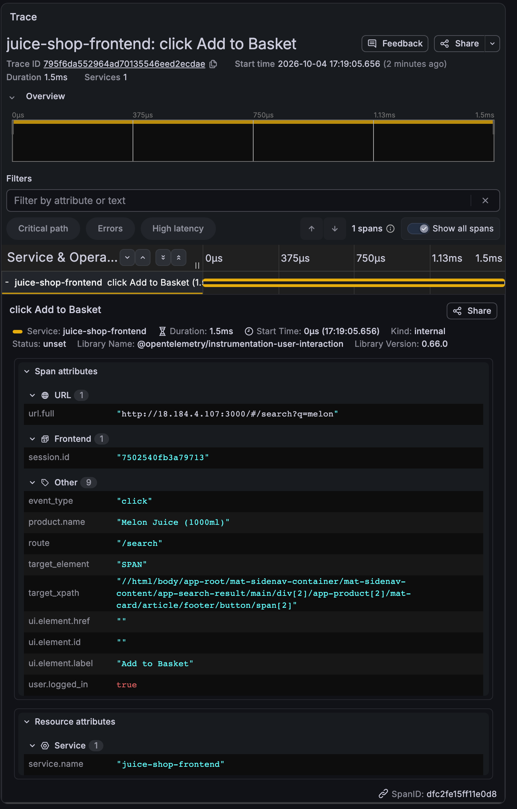

# 1. Frontend tracer (`overlay/frontend/src/tracer.ts`)

**Before:** the file does not exist. Juice Shop has no OpenTelemetry code.
**After:** [about 150 lines](../../overlay/frontend/src/tracer.ts). The first 35 or so give you
page-load, click and fetch spans. Everything after that makes the data answer business
questions. Layers 1 to 6 stand alone; layer 7 depends on layer 2, so you can stop at any of them.

## Layer 1: the basics (what you get with no thought)

```ts
const provider = new WebTracerProvider({
  resource: resourceFromAttributes({ [ATTR_SERVICE_NAME]: 'juice-shop-frontend' }),
  spanProcessors: [new BatchSpanProcessor(new OTLPTraceExporter({ url: collectorUrl }))]
})
provider.register({ contextManager: new ZoneContextManager() })

registerInstrumentations({
  tracerProvider: provider,
  instrumentations: [
    new DocumentLoadInstrumentation(),
    new UserInteractionInstrumentation(),
    new FetchInstrumentation({ ignoreUrls: [/\/assets\/i18n\//] })
  ]
})
```

Result in Tempo: a span called `click` with `target_element=SPAN` and a long xpath. No
label, no id. A dashboard built on this says "clicks: 0.4/s" and nothing else.

## Layer 2: name the clicks

**Before:** `new UserInteractionInstrumentation()`

**After:**

```ts
new UserInteractionInstrumentation({
  eventNames: ['click', 'submit'],          // login runs on form submit, not click
  shouldPreventSpanCreation: (event, element, span) => {
    const d = describe(element)             // closest button/link: id, aria-label, text, routerLink
    span.setAttribute('ui.element.id', d.id)
    span.setAttribute('ui.element.label', d.label)
    span.setAttribute('ui.element.href', d.href)
    span.updateName(`${event} ${d.id || d.label || element.tagName.toLowerCase()}`)
    return false                            // false = keep the span
  }
})
```

Result: `click` becomes `click loginButton`, `click Add to Basket`, `submit login-form`.
Side effect: anything that filtered on `name = "click"` stops matching. The technical
dashboard now filters on `span.event_type = "click"` ([change 6](06-technical-dashboard.md)).

`describe()` never reads input values, and names inputs and forms by id only.

## Layer 3: page views

**Before:** `documentLoad` fires once per tab. In a hash-routed single-page app nothing
says where the user went next.

**After:**

```ts
window.addEventListener('hashchange', () => {
  tracer.startSpan('navigation', { attributes: { route: currentRoute() } }).end()
})
```

`currentRoute()` collapses ids (`/order-completion/5267-...` becomes `/order-completion/:id`)
so routes stay countable.

## Layer 4: session and signed-in flag

**Before:** spans are anonymous and unrelated to each other.

**After:** a span processor stamps every span:

```ts
onStart (span) {
  span.setAttribute('session.id', sessionId)                          // random, per tab
  span.setAttribute('user.logged_in', !!localStorage.getItem('token')) // boolean only
}
```

No email and no user id leave the browser. This is also how you join a click to the API
call it caused: the two are not parent and child (see the main README), but they share
`session.id` and a timestamp.

## Layer 5: JavaScript errors

**Before:** none of the three instrumentations records a JS error.

**After:**

```ts
function reportError (type: string, message: unknown) {
  const span = tracer.startSpan('exception', { attributes: {
    'exception.type': type, 'exception.message': String(message).slice(0, 120), route: currentRoute() } })
  span.setStatus({ code: SpanStatusCode.ERROR })
  span.end()
}
window.addEventListener('error', e => reportError('error', e.message))
window.addEventListener('unhandledrejection', e => reportError('unhandledrejection', (e.reason as Error)?.message ?? e.reason))
```

Known limit: `unhandledrejection` never fires here, because Angular's zone.js handles rejected
promises before the browser event.

## Layer 6: product and search context (business metrics)

**Before:** an Add to Basket click is `click Add to Basket`, for every product. A page view
of a search is `navigation` with `route=/search`.

**After:**

```ts
// in the click hook
if (element.closest('button.btn-basket')) {
  const product = element.closest('mat-card')?.querySelector('.name')?.textContent?.trim()
  if (product) span.setAttribute('product.name', product.slice(0, 60))
}

// in the hashchange listener
const term = new URLSearchParams(window.location.hash.split('?')[1] ?? '').get('q')?.trim().toLowerCase().slice(0, 40)
tracer.startSpan('navigation', { attributes: { route: currentRoute(), ...(term ? { 'search.term': term } : {}) } }).end()
```

Two things to know before copying this. The `.name` selector is Juice Shop's own DOM, so
it needs rewriting for your app. And a search term is text a user typed: decide whether you
want it in your tracing backend before you ship it.

Result in Tempo:



## Layer 7: bring the click and its API calls into one trace

**Before:** a click span and the `fetch` it triggers are separate traces. Angular calls `fetch`
outside the context the click span was made active in, so the Fetch instrumentation finds no
parent and starts a new trace.

**After:** remember the last click or submit span, and call `fetch` inside its context if the
call starts within 300 ms:

```ts
lastClick = { span, at: performance.now() }          // in the click hook

const instrumentedFetch = window.fetch
window.fetch = (...args) => {
  if (lastClick && performance.now() - lastClick.at < 300) {
    const ctx = trace.setSpan(context.active(), lastClick.span)
    return context.with(ctx, () => instrumentedFetch.apply(window, args))
  }
  return instrumentedFetch.apply(window, args)
}
```

**Measured** on 2 rounds of 6 scripted shoppers, after the duplicate fix of layer 8 (2026-10-13):

| Click or submit span | Spans | With child API call | What the children were |
| --- | --- | --- | --- |
| `submit login-form` | 20 | 20 | `POST /rest/user/login` 20 of 20, plus the reads that follow a login |
| `click Add to Basket` | 12 | 12 | `POST /api/BasketItems` 12 of 12, plus basket and product reads |

Without the wrapper, none of the 7 click traces we inspected had a child; with it, 6 of 7 held the
click, the browser's `fetch` and the backend's server span in one trace.

**The cost:** it is a time heuristic, not causality. Any request that starts within 300 ms of an
interaction is adopted, whether or not the interaction caused it. One `click dismiss cookie
message` span adopted a `POST /api/Users`, which was our test script calling `fetch` directly.
Traces get larger. Dashboards are unaffected: they read the `fetch` and server spans, whose names
and attributes did not change. A wrapper that relies on the framework's own change detection (for
example Angular's `NgZone`) would be more exact, and we did not try it.

## Layer 8: one click, one span

**Before:** a single click on a basket button could produce two identical spans. In the lab the
product counts were doubled for some products: a user added one of each product and the panel
showed 2 for some of them.

**Why:** with zone.js the user-interaction instrumentation opens one span per event **listener
task** that runs for the event, not one per click (`_patchZoneRunTask` calls `_createSpan` for
each task). A button with two click listeners yields two spans, a few hundred microseconds apart,
same element, same session. The first click after a page loads had one listener and made one span;
later clicks had two. It also inflated `Clicks by element`, the cookie banner and welcome
banner counts, and an earlier version of the click-to-request numbers above (20 spans for 18 clicks).

**After:** the hook drops a span for the same element and the same event type that follows another
within 50 ms:

```ts
const DUPLICATE_WINDOW_MS = 50
let lastInteraction = { element: null, type: '', at: -Infinity }
// in shouldPreventSpanCreation:
const now = performance.now()
if (element === lastInteraction.element && event === lastInteraction.type && now - lastInteraction.at < DUPLICATE_WINDOW_MS) return true
lastInteraction = { element, type: event, at: now }
```

Returning `true` from `shouldPreventSpanCreation` discards the span before it is stored.

**Verified** (2026-10-13), 2 rounds of 6 scripted shoppers: 12 `click Add to Basket` spans against 12
`POST /api/BasketItems` server spans against 12 add clicks the script made, 20 `submit login-form`
spans for 20 login attempts, and no two spans from one session with the same name within 5 ms.

**Limit:** two real, deliberate clicks on the same element within 50 ms would count once. Nobody
clicks that fast, but an automated test could.
